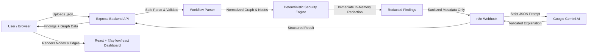

# FlowSentry AI

> **Inspect an automation workflow before trusting it.**  
> Static security analysis, visual graph inspection, and evidence-backed AI explanations for exported n8n workflows. Built for **VORTEX 2K26**.

---

## 🛡️ Overview

**FlowSentry AI** is a security-focused developer tool that statically inspects exported [n8n](https://n8n.io/) workflow files (`.json`) for potential security risks, data exposure, credential misuse, and suspicious external destinations.

Rather than running blind in production, developers and teams can upload their workflow export to instantly inspect:
1. **Interactive Node Graph:** Visual representation of workflow triggers, operations, and data paths powered by `@xyflow/react`.
2. **Deterministic Risk Scanner:** Fast, offline-first security checks detecting secret-like values, external request destinations, credential reference configurations, and destructive actions.
3. **AI Explanations via n8n & Gemini:** Plain-language security analysis and mitigation guidance orchestrating Google Gemini through n8n Cloud webhooks.

### 🔒 Core Privacy & Security Guardrails
- **Zero Workflow Execution:** FlowSentry AI never executes, imports, triggers, or runs uploaded workflows.
- **Immediate Secret Redaction:** Potential secrets, API keys, and tokens are redacted immediately in memory upon parsing. Raw secrets are never echoed in findings, saved in logs, sent to external services, or stored in databases.
- **Minimal AI Payload:** Raw workflow JSON and parameter blobs are never sent to Gemini. Only sanitized finding titles, affected node IDs, and redacted evidence are passed through the n8n webhook.
- **Conservative Findings:** Unfamiliar URLs and credentials are flagged for manual review with explicit limitations, rather than falsely labeled as malicious.

---

## 📐 Architecture



---

## 🛠️ Tech Stack

- **Frontend:** React 19, Vite, `@xyflow/react`, Vanilla CSS design system.
- **Backend:** Node.js (v20+ / v24+), Express (ES modules), CORS.
- **Security Engine:** Pure JavaScript deterministic scanner with regex redaction rules.
- **AI Orchestration:** n8n Cloud webhook + Google Gemini.
- **Database (Optional):** MongoDB Atlas for scan history.
- **Hosting Targets:** Vercel (Frontend) and Render (Backend).

---

## 🚀 Getting Started

### Prerequisites
- Node.js `v20.0.0` or higher (tested on Node `v24`)
- npm `v10` or higher

### 1. Clone the repository
```bash
git clone https://github.com/srirammulukuntla11/FlowSentry-AI.git
cd FlowSentry-AI
```

### 2. Backend Setup
```bash
cd backend
npm install
cp .env.example .env
npm run dev
```
*Backend runs on `http://localhost:5000`.*  
Verify health check: `http://localhost:5000/api/health`

### 3. Frontend Setup
```bash
cd ../frontend
npm install
npm run dev
```
*Frontend runs on `http://localhost:5173` with automated API proxy to backend.*

### 4. Running Backend Tests
```bash
npm --prefix backend test
```

### 5. Testing the Workflow Upload API
Upload an exported n8n workflow file (`.json`, max 2 MB) using `curl`:

```bash
# Test with the safe synthetic sample
curl -F "workflow=@samples/safe-sample.json" http://localhost:5000/api/scans

# Test with the risky synthetic sample
curl -F "workflow=@samples/risky-sample.json" http://localhost:5000/api/scans
```

The response returns parsed workflow metadata, normalized graph nodes and edges, deterministic findings, and validated AI explanations (if configured). Uploaded workflows are never executed or persisted to disk.

### 6. Configuring n8n & Gemini AI Explanations
See [`n8n/README.md`](n8n/README.md) for full instructions on building the companion n8n Cloud webhook workflow and connecting Google Gemini credentials. Set `N8N_WEBHOOK_URL` in `backend/.env` to enable AI explanations; when unset or unreachable, FlowSentry AI automatically falls back to honest rule-based reporting.

---

## ⚙️ Environment Variables

### `backend/.env.example`
| Variable | Description | Default |
| :--- | :--- | :--- |
| `PORT` | Backend HTTP listening port | `5000` |
| `NODE_ENV` | Environment mode (`development` / `production`) | `development` |
| `MAX_UPLOAD_MB` | Maximum allowed workflow file size in megabytes | `2` |
| `N8N_WEBHOOK_URL` | Webhook URL for n8n + Gemini analysis workflow | *(empty / optional)* |
| `N8N_REQUEST_TIMEOUT_MS` | Timeout for n8n AI webhook in milliseconds | `8000` |
| `MONGODB_URI` | MongoDB Atlas connection string for scan history | *(empty / optional)* |

---

## 📋 Deterministic Security Rule Set

| Rule ID | Severity | Purpose |
| :--- | :--- | :--- |
| `SECRET_LIKE_VALUE` | **High** | Scans parameters for hardcoded API keys, tokens, bearer secrets, and private keys. Value is immediately redacted. |
| `EXTERNAL_HTTP_DESTINATION` | **Medium** | Identifies outbound HTTP Request nodes and flags external domains for review. |
| `SENSITIVE_TO_EXTERNAL_FLOW` | **Medium** | Tracks evidence-supported paths from sensitive inputs (e.g., forms, webhooks) to external endpoints. |
| `CREDENTIAL_REFERENCE_REVIEW` | **Low** | Identifies credential references configured on nodes, noting that n8n exports rarely include actual keys. |
| `DESTRUCTIVE_ACTION_REVIEW` | **Medium** | Flags potentially destructive database or filesystem operations (e.g. DELETE, DROP). |
| `UNKNOWN_NODE_COVERAGE` | **Info** | Reports unsupported or unknown custom node types where scanner coverage cannot be verified. |

---

## ⚠️ Limitations & Disclosure

- FlowSentry AI performs **static heuristic analysis** on workflow configuration files. It does not certify that a workflow is completely secure or free from vulnerabilities.
- Heuristic pattern matching can produce false positives. Findings are presented as items for human review with confidence levels and limitations noted.
- Workflows using complex arbitrary JavaScript expressions (`$json[...]`) may have partial coverage.

---

## 📄 License
MIT License. Created for VORTEX 2K26 Hackathon.
